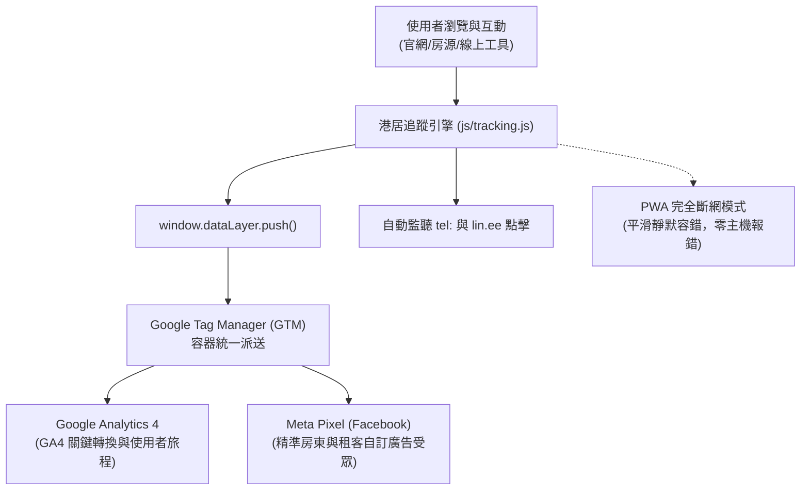

# 港居不動產 全站 MarTech 行銷科技與關鍵轉換追蹤設定規格說明書 (GTM / GA4 / Meta Pixel)

> **文件版本**：v1.0.0 (正式交付版)  
> **制定日期**：2026-10-24  
> **依據標準**：港居不動產高優質住宅包租代管官方網站建置需求規格書 (RFP) §5.1 行銷與成效追蹤規範、§5.2 法規合規、§6.2 專案交付項目  
> **適用平台**：港居不動產品牌官網 (`index.html`)、13 款線上工具集、3D 智慧營運島與隱私權專頁 (共 15 頁)  

---

## 一、 追蹤系統架構概覽 (Tracking Architecture)

為兼顧**行銷精準成效追蹤**、**個人資料保護法規（PDPA）**與**純前端離線 PWA 高效能**，港居不動產採用標準資料層（Data Layer）中介架構：



### 1.1 設計核心原則
1. **單一資料來源 (Single Source of Truth)**：所有轉換動作由 `js/tracking.js` 統一標準化派送，嚴禁各頁面死寫雜亂的追蹤腳本。
2. **非侵入式與容錯保證 (Graceful Degradation)**：若使用者啟用廣告阻擋器 (AdBlocker)、停用 Cookie 或處於案場完全斷網離線環境，追蹤核心保證 100% 靜默無痛容錯，全站功能完全不受任何影響。
3. **無個人識別資訊傳輸 (No PII Policy)**：嚴格遵循台灣《個人資料保護法》，姓名、完整手機號碼與身分證號絕不上傳至 GA4 或 Meta Pixel，僅傳送去識別化維度（如房屋區域、意向方案、房源編號）。

---

## 二、 資料層 (Data Layer) 標準規格

### 2.1 全域標準事件結構
每次觸發事件，`window.dataLayer.push` 均會封裝以下基底欄位：

```javascript
window.dataLayer.push({
  event: 'lead_form_submit',               // 必填：標準事件名稱 (snake_case)
  page_title: document.title,              // 自動：頁面標題
  page_location: window.location.href,      // 自動：完整網址
  page_path: window.location.pathname,      // 自動：相對路徑
  timestamp: '2026-10-24T20:50:00.000Z',   // 自動：ISO 8601 時間戳記
  client_platform: 'ganju-web-static',     // 自動：前端客戶端代號
  // ... 其他依事件自訂之維度與指標
});
```

---

## 三、 全站關鍵轉換與行為事件清單 (Master Event Dictionary)

根據 RFP §5.1 要求，全站共實作 9 大核心轉換與互動事件：

| # | 事件名稱 (`event`) | 事件層級 | 觸發時機 | 自訂參數 (Parameters) | GA4 轉換標記 | Meta Pixel 對應 |
|---|---|---|---|---|---|---|
| 1 | `lead_form_submit` | **主要轉換 (Macro)** | 首頁資產評估表單成功送出 | `region`, `plan_intent`, `has_note` |  標記為轉換 | `Lead` |
| 2 | `line_consult_click` | **主要轉換 (Macro)** | 點擊全站任一 LINE 官方諮詢按鈕 | `source_location`, `destination_url` |  標記為轉換 | `Contact` |
| 3 | `phone_call_click` | **主要轉換 (Macro)** | 點擊撥打公司或經理電話 | `phone_number`, `source_location` |  標記為轉換 | `Contact` |
| 4 | `property_line_book` | **主要轉換 (Macro)** | 房源詳情彈窗內點擊「加 LINE 預約看房」 | `listing_id`, `listing_title`, `price` |  標記為轉換 | `Schedule` |
| 5 | `property_view` | 次要轉換 (Micro) | 點擊房源卡片開啟詳細資訊彈窗 | `listing_id`, `listing_title`, `price`, `district` | 一般事件 | `ViewContent` |
| 6 | `roi_calculator_use` | 互動事件 (Engagement) | 拖拉或變更首頁 ROI 收益試算器 | `monthly_rent`, `plan_mode` | 一般事件 | `CustomizeProduct` |
| 7 | `blog_article_view` | 內容互動 (Engagement) | 點擊專欄文章「閱讀全文」開啟彈窗 | `article_id`, `article_title`, `category` | 一般事件 | `ViewContent` |
| 8 | `blog_cta_click` | 漏斗推進 (Funnel) | 專欄彈窗文末點擊「專用工具」推薦按鈕 | `article_id`, `target_tool` | 一般事件 | 自訂事件 |
| 9 | `tax_calculator_eval` | 工具轉換 (Tool) | 房東於節稅試算器完成試算或匯出診斷書 | `monthly_rent`, `tax_bracket`, `saved_amount` | 一般事件 | `CustomizeProduct` |

---

## 四、 程式碼埋設與自動捕獲機制

### 4.1 全自動捕獲 (Automatic Delegation)
`js/tracking.js` 透過全域事件代理，自動攔截以下元件，免去工程師逐一綁定：
1. **外連 LINE 官方帳號**：任何 `href` 包含 `lin.ee` 之連結，自動觸發 `line_consult_click`，自動抓取按鈕文字或 `title` 為 `source_location`。
2. **撥打電話**：任何 `href` 以 `tel:` 開頭之連結，自動觸發 `phone_call_click`，自動抓取電話號碼與按鈕位置。
3. **自訂屬性元素**：標記 `data-track-event="my_event"` 之元素，點擊時自動解析所有 `data-track-*` 屬性並送出事件。

### 4.2 程式碼主動觸發範例 (Programmatic Dispatch)
```javascript
// 範例：表單送出成功後觸發
if (window.GanjuTracker) {
  window.GanjuTracker.track('lead_form_submit', {
    region: '小港區',
    plan_intent: 'sublease_full',
    has_note: true
  });
}
```

---

## 五、 Google Tag Manager (GTM) 容器部署指南

### 5.1 GTM 容器安裝代碼
將以下代碼置於全站 HTML 頁面：

**A. 貼於 `<head>` 區塊盡可能靠前的位置：**
```html
<!-- Google Tag Manager -->
<script>(function(w,d,s,l,i){w[l]=w[l]||[];w[l].push({'gtm.start':
new Date().getTime(),event:'gtm.js'});var f=d.getElementsByTagName(s)[0],
j=d.createElement(s),dl=l!='dataLayer'?'&l='+l:'';j.async=true;j.src=
'https://www.googletagmanager.com/gtm.js?id='+i+dl;f.parentNode.insertBefore(j,f);
})(window,document,'script','dataLayer','GTM-XXXXXXX');</script>
<!-- End Google Tag Manager -->
```

**B. 貼於 `<body>` 緊接起始標籤的位置：**
```html
<!-- Google Tag Manager (noscript) -->
<noscript><iframe src="https://www.googletagmanager.com/ns.html?id=GTM-XXXXXXX"
height="0" width="0" style="display:none;visibility:hidden"></iframe></noscript>
<!-- End Google Tag Manager (noscript) -->
```

*(註：若尚未申請正式 GTM 容器 ID，全站維持由 `js/tracking.js` 本地原生派送 GA4/Meta Pixel，不會產生任何 404 報錯。)*

### 5.2 GTM 觸發程序 (Triggers) 設定

| 觸發程序名稱 | 類型 | 事件名稱 | 觸發條件 |
|---|---|---|---|
| **CE - Lead Form Submit** | 自訂事件 (Custom Event) | `lead_form_submit` | 所有自訂事件 |
| **CE - Line Consult Click** | 自訂事件 (Custom Event) | `line_consult_click` | 所有自訂事件 |
| **CE - Phone Call Click** | 自訂事件 (Custom Event) | `phone_call_click` | 所有自訂事件 |
| **CE - Property Book** | 自訂事件 (Custom Event) | `property_line_book` | 所有自訂事件 |
| **CE - Property View** | 自訂事件 (Custom Event) | `property_view` | 所有自訂事件 |

### 5.3 GTM 代碼 (Tags) 設定
1. **代碼 1：GA4 配置代碼 (Google Tag)**
   - 標籤 ID：`G-XXXXXXXXXX`
   - 觸發條件：`Initialization - All Pages`
2. **代碼 2：GA4 事件 - 資產評估表單送出**
   - 代碼類型：Google Analytics (GA4) 事件
   - 事件名稱：`lead_form_submit`
   - 事件參數：`region` = `{{dlv - region}}`, `plan_intent` = `{{dlv - plan_intent}}`
   - 觸發條件：`CE - Lead Form Submit`
3. **代碼 3：Meta Pixel - 標準 Lead 轉換**
   - 代碼類型：自訂 HTML
   - 內容：`<script>fbq('track', 'Lead', { content_name: {{dlv - plan_intent}} });</script>`
   - 觸發條件：`CE - Lead Form Submit`

---

## 六、 Google Analytics 4 (GA4) 自訂維度與轉換設定

登入 GA4 報表後台，於「管理」>「自訂定義 (Custom Definitions)」新增以下維度：

| 維度名稱 | 範圍 (Scope) | 事件參數名稱 (Event Parameter) | 說明 |
|---|---|---|---|
| **房屋區域** | 事件 (Event) | `region` | 表單填寫之高雄行政區（如：小港區、前鎮區） |
| **意向方案** | 事件 (Event) | `plan_intent` | 房東意向（全包租、精緻代管、未定） |
| **點擊來源位置** | 事件 (Event) | `source_location` | 觸發按鈕位置（如：懸浮按鈕、頁尾、彈窗） |
| **房源編號** | 事件 (Event) | `listing_id` | 物件唯一識別碼 |
| **文章標題** | 事件 (Event) | `article_title` | 專欄閱讀文章標題 |

### 標記主要轉換 (Key Events / Conversions)
於 GA4「管理」>「轉換 (Key Events)」將下列 4 項事件開啟為轉換：
1. `lead_form_submit` (表單線索)
2. `line_consult_click` (LINE 諮詢)
3. `phone_call_click` (來電洽詢)
4. `property_line_book` (看房預約)

---

## 七、 測試、驗證與品質保證 (QA & Validation)

1. **GTM 預覽模式 (Tag Assistant)**：
   - 開啟 `https://tagassistant.google.com/` 連線至官網。
   - 執行表單送出、點擊懸浮 LINE、開啟房源彈窗。
   - 驗證 Summary 面板中事件是否正常出現於 DataLayer 且代碼成功觸發 (Tags Fired)。
2. **GA4 DebugView 實機檢驗**：
   - 於 Chrome 安裝 Google Analytics Debugger 擴充套件。
   - 至 GA4「管理」>「DebugView」即時觀察事件與參數值是否有正確傳入。
3. **Meta Pixel Helper 驗證**：
   - 使用 Meta Pixel Helper 檢測 `Lead`、`Contact`、`ViewContent` 是否有打出綠勾。

---
*港居不動產開發有限公司 GANJU Real Estate Co., Ltd. 數位資產管理規範文件*
